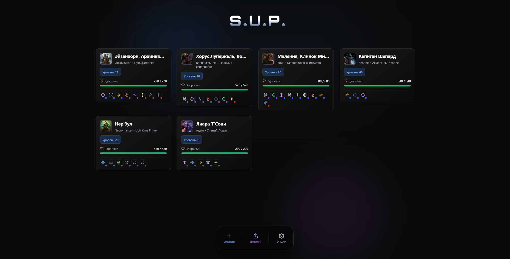
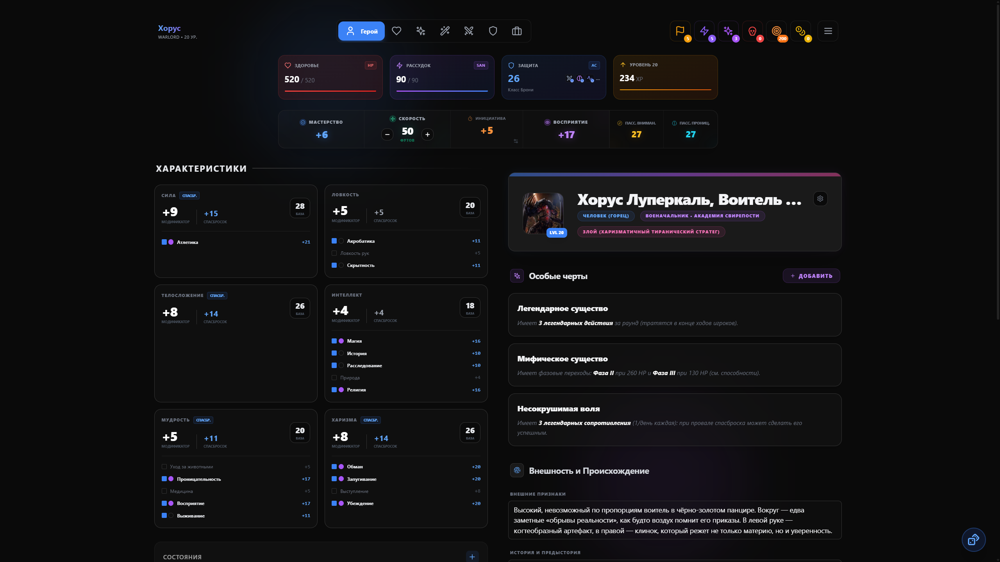
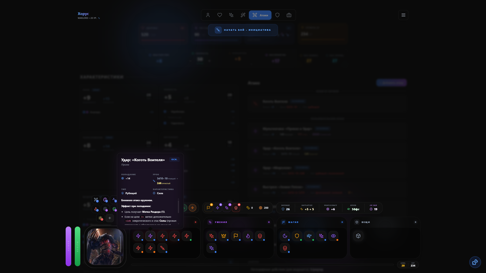

<p align="center">
  
</p>

<h1 align="center">S.U.P. — Система Управления Персонажем</h1>

<p align="center">
  Лист персонажа для настольной ролевой игры «Into the Dark»: создание героя, здоровье и травмы,
  рассудок, инвентарь, заклинания, боевой режим, броски кубиков. Работает в браузере и без сети,
  синхронизируется между устройствами.
</p>

---

## Быстрый старт (Docker)

```bash
cp .env.example .env
# впишите в .env длинный случайный JWT_SECRET:
node -e "console.log(require('crypto').randomBytes(48).toString('base64url'))"

docker compose up -d --build
```

Приложение: **http://localhost:3000**. Первый пользователь регистрируется на экране входа
(или через CLI, если регистрация закрыта — см. ниже).

| Сервис     | Что это                                   | Порт                      |
| ---------- | ----------------------------------------- | ------------------------- |
| `web`      | nginx: SPA + прокси `/api` и WebSocket     | `3000` → 8080             |
| `api`      | Node.js API (Fastify)                     | только внутри сети compose |
| `postgres` | PostgreSQL 17                             | `127.0.0.1:5432`          |

## Разработка

Нужны Node.js 22.6+ и Docker.

```bash
npm install
cp .env.example .env          # и задайте JWT_SECRET
npm run db:up                 # Postgres в Docker
npm run dev                   # API на :4000 и Vite на :3000 с hot reload
```

| Команда             | Что делает                                         |
| ------------------- | -------------------------------------------------- |
| `npm run dev`       | API (`tsx watch`) + фронт (Vite), прокси `/api`    |
| `npm run check`     | проверка типов, линтер и все тесты                 |
| `npm test`          | тесты всех пакетов (API — на реальном Postgres)    |
| `npm run build`     | production-сборка API и фронта                     |
| `npm run cli -- …`  | административные команды (см. ниже)                |

Тесты API создают отдельную базу `itd_test` в том же Postgres, поэтому перед `npm test` нужен
`npm run db:up`.

## Администрирование

```bash
# создать аккаунт (работает и при REGISTRATION_ENABLED=false)
npm run cli -- create-user --email player@example.com --name "Игрок" --password "…"

# задать новый пароль игроку, который забыл свой (его сессии завершатся); сменить его игрок может в настройках
npm run cli -- reset-password --email player@example.com --password "…"

# импортировать листы персонажей (JSON-файлы или папка; в том числе из десктопной версии)
npm run cli -- import-characters --email player@example.com ./data/legacy

# то же самое в Docker
docker compose exec api node dist/cli.js create-user --email … --name … --password …
```

Персонажей из старой браузерной версии (localStorage) приложение переносит в аккаунт само при
первом входе в этом браузере. Любой JSON-лист можно также загрузить кнопкой «Импорт».

## Структура

```
apps/
  api/            Fastify + Drizzle: аккаунты, хранение и синхронизация персонажей, WebSocket
  web/            React-приложение: UI, локальная база (IndexedDB), движок синхронизации
packages/
  schema/         zod-схема листа персонажа, миграции версий, слияние, контракты API
  game-logic/     правила системы и игровой контент — чистые функции без UI и сети
docs/             архитектура, скриншоты
```

Подробнее — в [docs/ARCHITECTURE.md](docs/ARCHITECTURE.md).

## Скриншоты

<p align="center">
  
  
  
</p>
